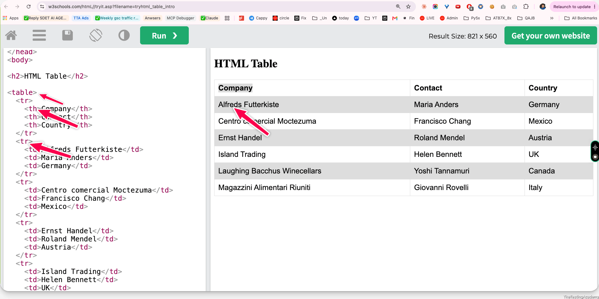

- **Count rows and columns before iterating through a table.**
- **Build dynamic XPath expressions** when demonstrating row and column indexes.
- Use XPath axes such as `following-sibling::td`  to read related cells in the same row.
- Prefer Playwright locators like `page.locator('table tbody tr', { hasText: '...' })`  for readable row targeting.
- Use `locator('td').nth(index)`  or `allInnerTexts()`  to extract individual cells or full row data.
- Remember that **XPath table indexes are one-based,** while Playwright `nth()`  indexes are zero-based.