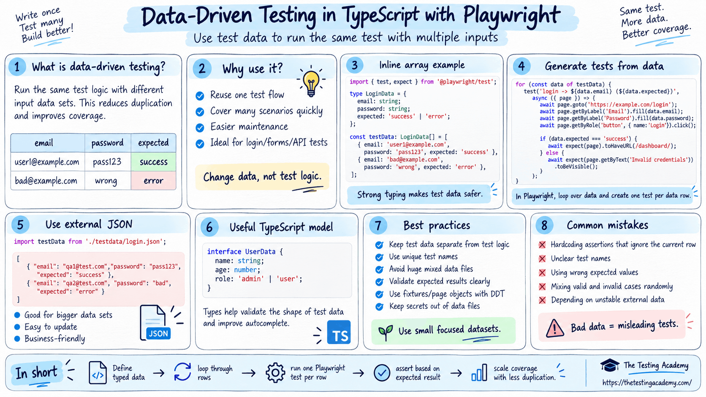

# Faker JS 
It is a third-party library which is used to generate fake test data which looks real in a dynamic format. 

Generate massive amounts of fake (but realistic) data for testing and development.

[www.npmjs.com/package/@faker-js/faker](https://www.npmjs.com/package/@faker-js/faker) 

Faker tries to generate realistic data and not obvious fake data.

## 🚀 Features
- 🧍 Person - Generate Names, Genders, Bios, Job titles, and more.
- 📍 Location - Generate Addresses, Zip Codes, Street Names, States, and Countries!
- ⏰ Date - Past, present, future, recent, soon... whenever!
- 💸 Finance - Create stubbed out Account Details, Transactions, and Crypto Addresses.
- 👠 Commerce - Generate Prices, Product Names, Adjectives, and Descriptions.
- 👾 Hacker - “Try to reboot the SQL bus, maybe it will bypass the virtual application!”
- 🔢 Number and String - Of course, we can also generate random numbers and strings.
- 🌏 Localization - Pick from over 70 locales to generate realistic looking Names, Addresses, and Phone Numbers.

import { test, expect } from '@playwright/test';
import { faker } from '@faker-js/faker';

const totalUserCount = 5;
const emailDomains = ['gmail.com', 'yahoo.com', 'outlook.com', 'tta.dev', 'icloud.com'];

for (let i = 1; i <= totalUserCount; i++) {
    test(`Register user# ${i} (${emailDomains[i - 1]})`, async ({ page }) => {
        const firstName = faker.person.firstName();
        const lastName = faker.person.lastName();
        const email = `${firstName.toLowerCase()}.${lastName.toLowerCase()}@${emailDomains[i - 1]}`;
        const password = faker.internet.password({ length: 20, memorable: true, pattern: /[A-Z]/, prefix: 'Auto ' });

        await page.goto('https://app.thetestingacademy.com/playwright/tables/practice.html');
        await page.getByRole('textbox', { name: 'First Name' }).fill(firstName);
        await page.getByRole('textbox', { name: 'Last Name' }).fill(lastName);
        await page.getByRole('textbox', { name: 'Email' }).fill(email);
        await page.getByRole('textbox', { name: 'Password' }).first().fill(password);
        await page.getByRole('button', { name: 'Save profile' }).click();
        await expect(page.locator('#submission-output')).toContainText(email);
    });
}

What is Data Driven Testing:

Data driven testing is a way of testing where you have an external data source and the application under test.

You basically use the external files or external test data to test application under the test multiple times with this.

Eg: Now you have an application under test, you have to test it with 1000 of students, they can be present in external source files - can be:

JSON - JavaScript Object Notation, it is a lightweight format used to store and transfer data between applications. This is mostly used one and recommended for Data driven.

CSV - 
Excel(xlsx, xls(old))
yaml
Txt(avoid) -- Avoid this, it's very difficult to read it.

JSON is commonly used in:
API Testing, Configuration files, Test Data, PW and Selenium Frameworks, Frontend and Backend Communications.

Important Rules of JSON:

2.  String values must use double quotes. 
3.  Key and value are separated by `:` . 
4.  Multiple properties are separated by `,` . 
5.  Objects use `{ }` . 
6.  Arrays use `[ ]` . 
7.  The last property must not have a comma.

**JSON Data Types**

**_JSON supports six main data types._**

**Data type	Example**
String	-> "Pramod"
Number	-> 15
Boolean	-> true
Null	-> null
Object	-> { "city": "Bangalore" }
Array	-> ["JavaScript", "Playwright"]

{
  "name": "Pramod",
  "experience": 15,
  "isTrainer": true,
  "middleName": null,
  "skills": ["JavaScript", "Playwright", "Selenium"],
  "address": {
    "city": "Bangalore",
    "country": "India"
  }
}

[todiagram.com/editor?utm_source=jsoncrack&utm_medium=promotion_modal&utm_campaign=editor_redirect](https://todiagram.com/editor?utm_source=jsoncrack&utm_medium=promotion_modal&utm_campaign=editor_redirect) 

[jsonpath.com/](https://jsonpath.com/) 

[jsonpathfinder.com/](https://jsonpathfinder.com/) 

[jsoncrack.com/editor](https://jsoncrack.com/editor) 
JSON vs. JavaScript Object:

JSON and JavaScript Objects are both used to represent data in JavaScript, but they are designed for different use cases. JSON focuses on data exchange, while JavaScript Objects are meant for working with data inside programs.

JSON is a text-based format used for storing and transmitting data, whereas JavaScript objects exist in memory and are used for program logic.

JSON has strict syntax rules (no functions, comments, or trailing commas), while JavaScript Objects are more flexible.

JavaScript Objects can include methods and complex logic, but JSON is limited to pure data only.

**JS Object != JSON**

JSON:
{
  "username": "admin",
  "password": "admin123"
}

JS Object:
`const user = {
  username: "admin",
  password: "admin123"
};` 

console.log(user.username);
console.log(user.password);

## Array of Objects

This is very common in API testing and automation.

An object having Array with different Objects

{
  "users": [
    {
      "id": 1,
      "name": "Pramod"
    },
    {
      "id": 2,
      "name": "Amit"
    }
  ]
}

{
  "employee": {
    "name": "Pramod",
    "address": {
      "city": "Bangalore",
      "pinCode": 560001
    }
  }
}

## Convert JSON String to JavaScript Object

const jsonText = `{
  "name": "Pramod",
  "role": "QA Engineer"
}`;

const user = JSON.parse(jsonText);
console.log(user.name);

## Convert JavaScript Object to JSON
const user = {
  name: "Pramod",
  role: "QA Engineer"
};

const jsonText = JSON.stringify(user);

console.log(jsonText);

Reading a JSON File in Node.js=

Create a file called user.json:

{
  "username": "admin",
  "password": "admin123"
}

